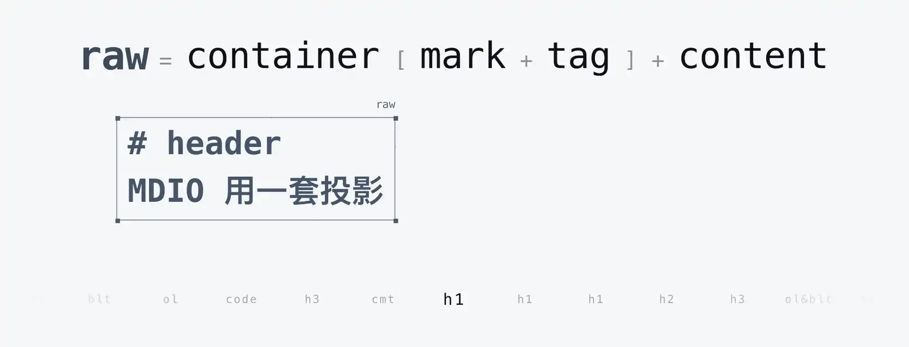
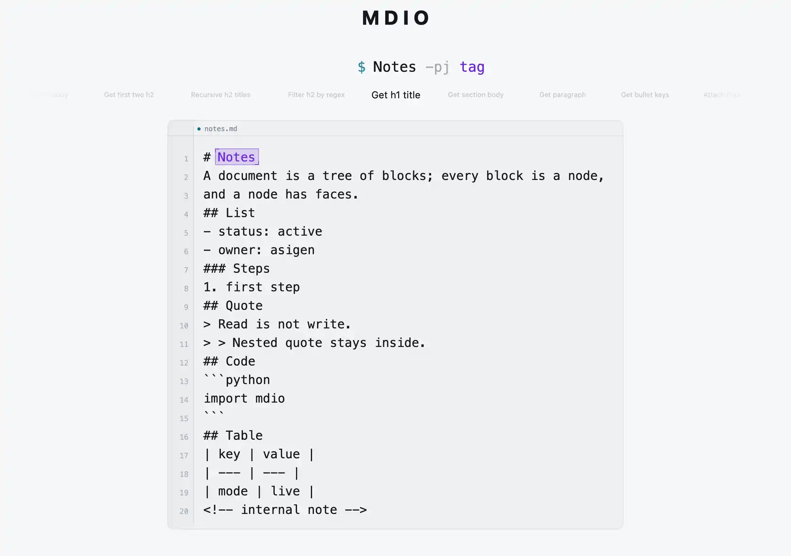
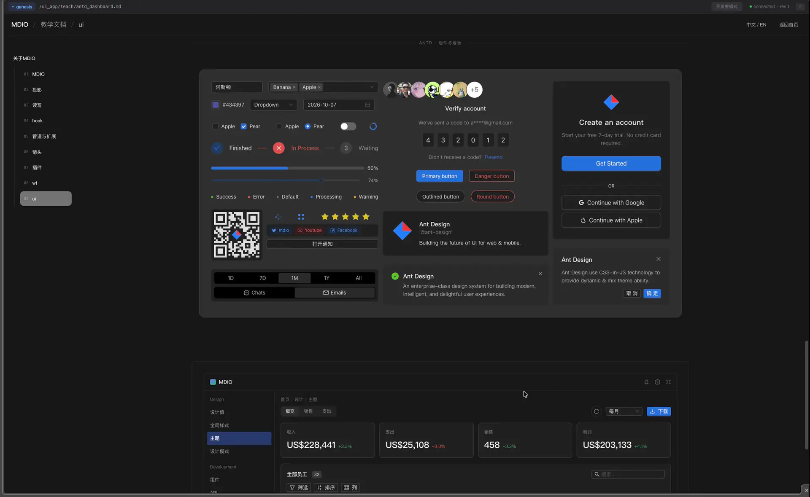

<div align="center">

# MDIO

[English](README.md) | [中文](README.zh.md) | [官网](https://md-io.org)

> MDIO is a Markdown environment.

<p align="center">
  
</p>

</div>


MDIO aims to build a better mother-tongue Markdown environment for LLMs, based on a unified projection:
- a selector syntax
- 5 read/write-isomorphic CRUD primitives
- 1 hook
- incremental parsing
- CRDT
- pipes, extensions, plugins
- worktree

MDIO supports incremental Markdown editing => per-edit Patch JSON & CRDT, and implements a frontend approach built purely on MD projection:
```
md edit(exec/crdt) -> wasm ws -> mdio_core -> ripple -> patch JSON -> mdio_ui
  -> MST(Mobx State Tree) applyPatch -> computed -> observer -> React render
```

MDIO provides an Arrow-based DuckDB extension:
```mdio_exec
$ /demo.md:: -pj raw | arrow -duckdb "
  select s.heading, count(*) as n
  from blocks b join sections s on b.path = s.path and b.section = s.section
  group by s.heading order by n desc limit 3
" -rows
```

<p align="center">
  <a href="https://md-io.org/">
    
  </a>
</p>

<p align="center">
  <sub>Animated preview · <a href="https://md-io.org/">open the interactive demo</a></sub>
</p>

<details>
<summary><strong>DEMO</strong> · Pure MD frontend mapping, live MD edits (CRDT or MDIO writes), live UI updates</summary>

<p align="center">
  <a href="./docs/assets/genesis-demo-2026-11-02-1920.webp">
    
  </a>
</p>

</details>

---

## Quick Start

Complete installation:

```bash
# 1. Install
uv tool install mdio-py

# 2. Load UI Apps
mdio load https://github.com/cloudwalkerfre/MDIO_WTS

# 3. Start Web
mdio web
```

Start only the gateway:

```bash
mdio serve
```

Check status:

```bash
mdio status
```

MCP client configuration (macOS/Linux):

```json
{
  "mcpServers": {
    "mdio": {
      "command": "mdio",
      "args": ["mcp"],
      "env": {
        "MDIO_GATEWAY_HOST": "127.0.0.1",
        "MDIO_GATEWAY_PORT": "8011"
      }
    }
  }
}
```

Windows:

```json
{
  "mcpServers": {
    "mdio": {
      "command": "wsl.exe",
      "args": [
        "-d",
        "Ubuntu-24.04",
        "--",
        "/home/<user>/.local/bin/mdio",
        "mcp"
      ]
    }
  }
}
```

`mdio mcp` automatically forwards stdio to the gateway. If the client supports Streamable HTTP, you can also connect directly:

```text
http://127.0.0.1:8011/mcp
```


## agent memory

For memory and knowledge-base work MDIO takes exactly one route: give the agent a single `exec` interface plus one skill markdown file. Everything else is convention.

- There is no universal pattern. TOC, Karpathy's index, a reference map and more — in my experience, the right one changes with the project, the phase, even the module. MDIO preach you none.
- The only rule worth keeping: tell agent **write so that it is easy to query later.**

## Platform Support

```text
macOS
Linux
Windows WSL2
```

## Loading worktrees

MDIO builds its VFS on OpenDAL:

- multiple worktrees
- local directories / remote GitHub repos
- iroh share / mount

```bash
# Local worktree
mdio load /path/to/project

# GitHub repository: downloaded to $MDIO_HOME/<repo> by default
mdio load https://github.com/owner/repo

# Branch / tag / commit
mdio load https://github.com/owner/repo --ref main

# List worktrees
mdio load https://github.com/owner/repo --list

# Load a selected worktree
mdio load https://github.com/owner/repo --wt chat

# Parse only; do not download or register
mdio load https://github.com/owner/repo --dry-run
```

## Remote mounting

```bash
mdio mount --ticket iroh://xxx --wt <wt_uid>
mdio share --wt <wt_uid>
mdio unmount --path /share/remote
```

## Development

### Requirements

- Rust stable (`rust-toolchain.toml`)
- Python 3.11+ (abi3 wheels); development uses 3.14 via [uv](https://docs.astral.sh/uv/) (`uv sync --python 3.14`)
- Node.js / pnpm: only for building the Web UI
- Docker: `just build-ui`
- `wasm32-unknown-unknown` + `wasm-bindgen`: WASM builds


### Initialization

```bash
cp .env.example .env
just install
```

### Build

```bash
just build-arrow      # DuckDB Arrow extension
just build-wasm       # WASM
just build-ui         # Assemble Web UI
just build            # Arrow extension + Web UI
just wheel            # Complete wheel
just verify           # Install wheel and boot a virtual genesis
just release          # Local release dry-run (verify + test)
```

### Development services

```bash
just serve             # Foreground gateway
just demo              # Demo UI
```

### Tests

```bash
just test-rust         # Rust workspace unit tests
just test-py           # Python tests
just test              # Rust + Python default tests
just test-py-slow      # slow integration tests
just test-omp          # OMP dual-mode regression
just test-trinity      # trinity judge suite
```

`justfile` is the only development entrypoint; all build, test, and release operations ultimately run through `tools/build_grid/runner.py`.

### Configuration

Config file:

```text
$MDIO_HOME/.env
```

Key variables:

```text
MDIO_GATEWAY_HOST
MDIO_GATEWAY_PORT
MDIO_WORKSPACE_ROOT
MDIO_PERSIST
```

Persistence is off by default; set `MDIO_PERSIST=1` to enable WAL and checkpointing.

## Limitations

- **Windows is supported through WSL2 only.** Native Windows is not supported; keep the workspace on the Linux filesystem (`/home/...`), not on `/mnt/c`.
- **limited support for refdef**
- **limited support html block**

## Roadmap

- A demo XBT SillyTavern-Style wt for Baldur's Gate 3
- genesis dashboard
- wasm build[lark_py => lark_js, python => pyodide, + core wasm]
- arrow incr(not through IPC)
- better safety model

## Acknowledgements

MDIO stands on open-source work. The pieces that shaped it most:

- **crop** and **cola** — the backbone of this project: the text rope and the text CRDT, by Riccardo Mazzarini (@noib3) under the @nomad org.
- **lark** — the selector grammar; **pexpect** — interactive shell sessions.
- **PyO3** and **maturin** — the Rust/Python boundary and packaging.
- **Apache OpenDAL** — the VFS storage layer.
- **Litestar** and **Granian** — the gateway.
- **Monaco Editor**, **React**, **esmx**, **Tailwind CSS** — the Web UI.
- **MobX** / **MobX-State-Tree** — applying patch JSON in the UI.
- **iroh** — remote share and mount.
- **CommonMark** — John MacFarlane and contributors; the specification ships as a test fixture.
- **DuckDB** and **Apache Arrow** — the columnar and SQL stage behind `arrow`.

## Vision

> Someday, LLMs internalise MDIO's projection syntax.

## License

MIT — see [LICENSE](LICENSE).
