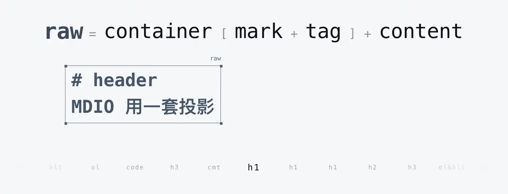
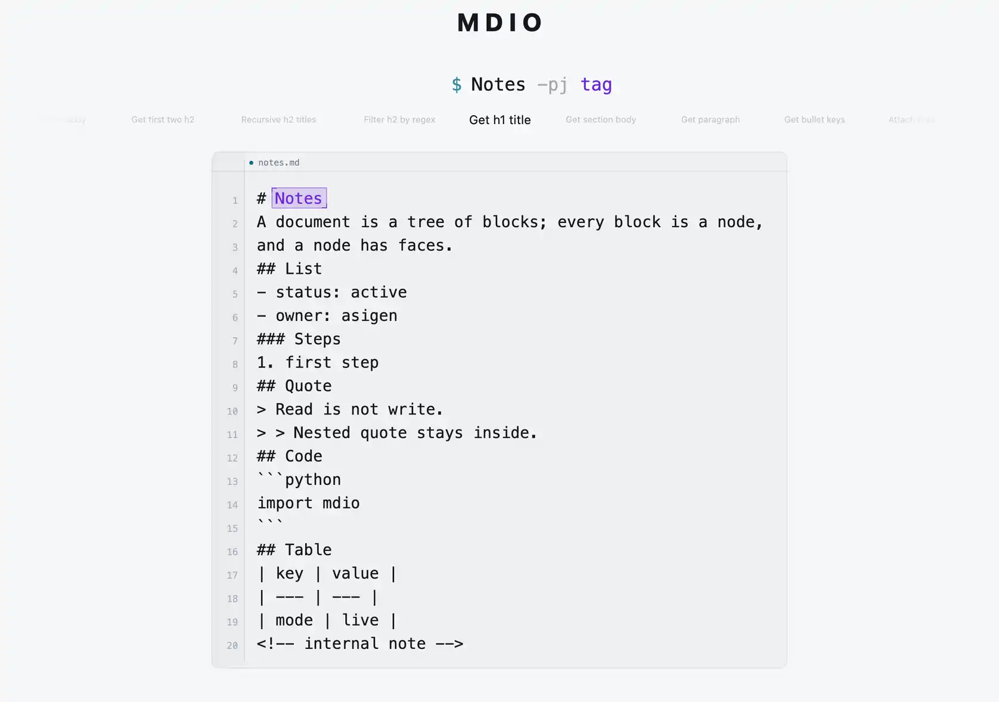
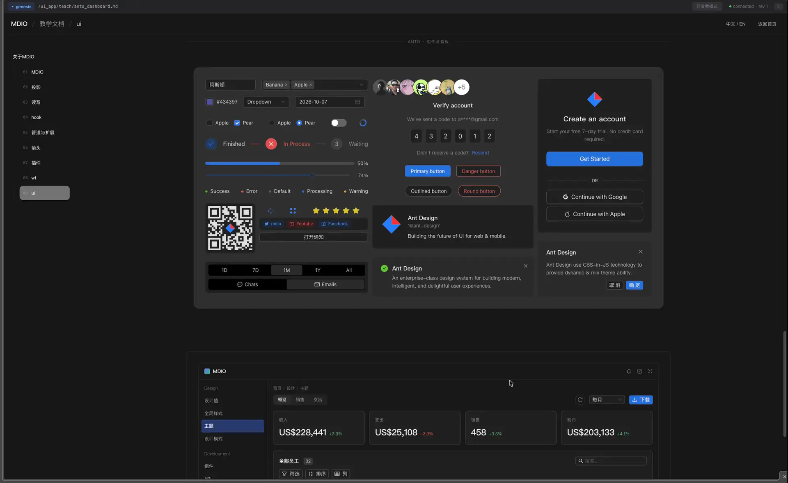

<div align="center">

# MDIO

[English](README.md) | [中文](README.zh.md) | [官网](https://md-io.org)

> MDIO 是一个 Markdown 环境。

<p align="center">
  
</p>

</div>


MDIO 尝试基于统一投影，为 LLM 构建更好的 Markdown 母语环境:
- 一套选择器语法
- 5个读写同构的CRUD原语
- 1个hook
- 增量解析
- CRDT
- 管道, 扩展, 插件
- worktree

MDIO 支持 Markdown 的增量编辑 => per edit Patch JSON & CRDT , 并实现了一套纯粹基于MD投影的前端方案:
```
md edit(exec/crdt) -> wasm ws -> mdio_core -> ripple -> patch JSON -> mdio_ui
  -> MST(Mobx State Tree) applyPatch -> computed -> observer -> React render
```

MDIO 提供一个基于 arrow 的 duckdb 插件:
```mdio_exec
$ /demo.md:: -pj raw | arrow -duckdb "
  select s.heading, count(*) as n
  from blocks b join sections s on b.path = s.path and b.section = s.section
  group by s.heading order by n desc limit 3
" -rows
```

<p align="center">
  <a href="https://md-io.org/">
    
  </a>
</p>

<p align="center">
  <sub>动态预览 · <a href="https://md-io.org/">打开交互演示</a></sub>
</p>

<details>
<summary><strong>DEMO</strong> · 纯 MD 前端映射, MD 实时编辑(CRDT 或 MDIO 写), UI 实时更新</summary>

<p align="center">
  <a href="./docs/assets/genesis-demo-2026-11-02-1920.webp">
    
  </a>
</p>

</details>

---

## 快速开始

完整安装：

```bash
# 1. 安装
uv tool install mdio-py

# 2. 加载 UI Apps
mdio load https://github.com/cloudwalkerfre/MDIO_WTS

# 3. 启动 Web
mdio web
```

只启动 gateway：

```bash
mdio serve
```

查看状态：

```bash
mdio status
```

在 MCP 客户端中配置(Mac/Linux)：

```json
{
  "mcpServers": {
    "mdio": {
      "command": "mdio",
      "args": ["mcp"],
      "env": {
        "MDIO_GATEWAY_HOST": "127.0.0.1",
        "MDIO_GATEWAY_PORT": "8011"
      }
    }
  }
}
```

Windows：

```json
{
  "mcpServers": {
    "mdio": {
      "command": "wsl.exe",
      "args": [
        "-d",
        "Ubuntu-24.04",
        "--",
        "/home/<user>/.local/bin/mdio",
        "mcp"
      ]
    }
  }
}
```

`mdio mcp` 自动 stdio 转发gateway, 如果客户端支持 Streamable HTTP，也可以直接连接：

```text
http://127.0.0.1:8011/mcp
```


## agent 记忆

记忆 / 知识库 等场景, MDIO 的方式就一个 => 给agent唯一exec接口和 skill md, 剩下的是约定:

- 个人认为, 并没有万金油范式, TOC, Karpathy's index, refmap 等等, 应该因地制宜, 甚至同一项目的不同阶段/模块, 都要灵活切换, mdio 不尝试给出任何范式
- 只一句最实用的: 让 agent 写的时候就想好怎么方便查

## 平台支持

```text
macOS
Linux
Windows WSL2
```

## 加载 worktree

MDIO 基于 OpenDAL 构建 VFS：

- 多 worktree
- 本地目录 / 远程 GitHub repo
- iroh share / mount

```bash
# 本地 worktree
mdio load /path/to/project

# GitHub 仓库：默认下载到 $MDIO_HOME/<repo>
mdio load https://github.com/owner/repo

# 指定分支 / tag / commit
mdio load https://github.com/owner/repo --ref main

# 列出 wt
mdio load https://github.com/owner/repo --list

# 选定加载
mdio load https://github.com/owner/repo --wt chat

# 只解析，不下载、不注册
mdio load https://github.com/owner/repo --dry-run
```

## 远程挂载

```bash
mdio mount --ticket iroh://xxx --wt <wt_uid>
mdio share --wt <wt_uid>
mdio unmount --path /share/remote
```

## 开发

### 要求

- Rust stable（`rust-toolchain.toml`）
- Python 3.11+（abi3 轮子）；开发环境用 3.14，经 [uv](https://docs.astral.sh/uv/)（`uv sync --python 3.14`）
- Node.js / pnpm：只用于构建 Web UI
- Docker：`just build-ui`
- `wasm32-unknown-unknown` + `wasm-bindgen`：WASM 构建


### 初始化

```bash
cp .env.example .env
just install
```

### 构建

```bash
just build-arrow      # DuckDB Arrow 扩展
just build-wasm       # WASM
just build-ui         # 组装 Web UI
just build            # Arrow 扩展 + Web UI
just wheel            # 完整 wheel
just verify           # 安装 wheel 并启动虚拟 genesis
just release          # 本地发布 dry-run（verify + test）
```

### 开发服务

```bash
just serve             # 前台 gateway
just demo              # demo UI
```

### 测试

```bash
just test-rust         # Rust workspace 单元测试
just test-py           # Python 测试
just test              # Rust + Python 默认测试
just test-py-slow      # slow 集成测试
just test-omp          # OMP 双模式回归
just test-trinity      # trinity 判官套件
```

`justfile` 是唯一开发入口；所有构建、测试、发布动作最终都通过 `tools/build_grid/runner.py` 执行。

### 配置

配置文件：

```text
$MDIO_HOME/.env
```

主要变量：

```text
MDIO_GATEWAY_HOST
MDIO_GATEWAY_PORT
MDIO_WORKSPACE_ROOT
MDIO_PERSIST
```

持久化默认关闭；设置 `MDIO_PERSIST=1` 启用 WAL 和 checkpoint。

## 限制

- **Windows 仅支持通过 WSL2。** 不支持原生 Windows；workspace 放在 Linux 文件系统（`/home/...`）上，不要放在 `/mnt/c`。
- **有限支持 refdef**
- **有限支持 html block**

## 路线图

- 一个面向《博德之门 3》的 XBT SillyTavern 风格演示 wt
- genesis 仪表盘
- wasm 构建[lark_py => lark_js, python => pyodide, + core wasm]
- arrow 增量（不走 IPC）
- 更完善的安全模型

## 致谢

MDIO 站在开源工作的肩上。影响最大的几件：

- **crop** 与 **cola** —— 本项目的支柱：文本 rope 与文本 CRDT，作者 Riccardo Mazzarini（@noib3），出自 @nomad 组织。
- **lark** —— 选择器语法；**pexpect** —— 交互式 shell 会话。
- **PyO3** 与 **maturin** —— Rust/Python 边界与打包。
- **Apache OpenDAL** —— VFS 存储层。
- **Litestar** 与 **Granian** —— gateway。
- **Monaco Editor**、**React**、**esmx**、**Tailwind CSS** —— Web UI。
- **MobX** / **MobX-State-Tree** —— 在 UI 里应用 patch JSON。
- **iroh** —— 远程 share 与 mount。
- **CommonMark** —— John MacFarlane 及贡献者；规范作为测试语料随仓库分发。
- **DuckDB** 与 **Apache Arrow** —— `arrow` 背后的列式 SQL 层。

## 愿景

> 希望有一天 LLM 能内化 MDIO 投影语法

## License

MIT — 参见 [LICENSE](LICENSE)。
