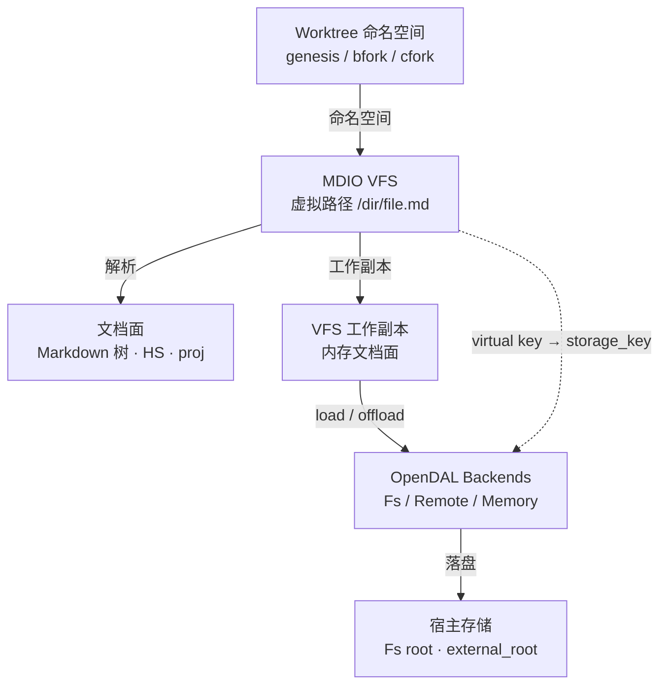
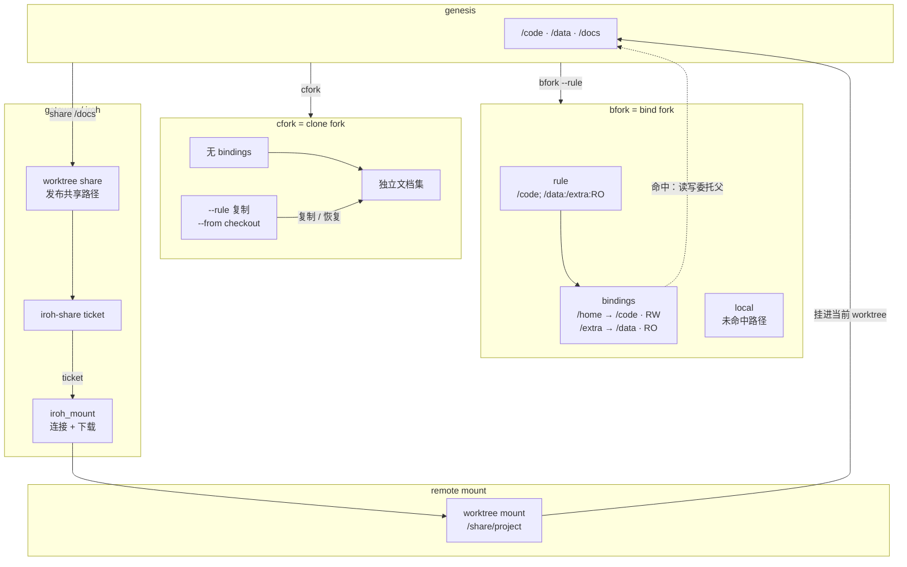

# MDIO 基础

> MDIO exec 不是 Shell, 是 mdio **内部**命令管道

## VFS

MDIO 的文档放在 VFS 中：`/dir/file.md` 是虚拟路径，不是宿主文件系统路径。每个 worktree 有自己的 VFS 命名空间；worktree 的细节在后面的“工作树”章单独讲。

- VFS 给选择器提供路径；文档面是解析后的 Markdown 树（HS + proj）。
- 实际读写发生在内存工作副本中，再由 OpenDAL Backends 对账到底层存储。
- OpenDAL Backends 支持 Fs / Remote / Memory 等实现，Fs 只是其中一种。
- `load` / `offload` 负责工作副本与底层往返；WAL 在文档根之外。



## §0 概念框架

MDIO 将 Markdown 投影为 `HS + proj`。

- **HS：header section 拓扑**
  - header 是节；非 header block 归它前面最近的 header；header 可嵌套。
  > ```text
  > # 项目                         [head h1]
  > ├─ ## 配置                     [head h2]
  > │  ├─ - 端口: 8080             [bullet]
  > │  ├─ > 本地配置               [bq]
  > │  ├─ 1. 先启动服务            [ol]
  > │  ├─ 普通段落文本              [p]
  > │  ├─ | 列 | 值 |              [tb]
  > │  └─ <!-- 备注 -->            [comment]
  > ├─ ## 任务                     [head h2]
  > │  ├─ - 待办: 写文档           [bullet]
  > │  ├─ ```python                [code]
  > │  └─ ### 子任务               [head h3]
  > │     └─ - 子项: 测试          [bullet]
  > └─ ## 日志                     [head h2]
  >    └─ > 记录一                 [bq]
  > ```

- **proj：每个 block 的五面**
  > raw = container[ mark + tag ] + content
  >
  > 以 `- 端口: 8080` 为例：
  > raw = "- 端口: 8080"
  >  ├─ container = "- 端口: "
  >  │    ├─ mark = "-"
  >  │    └─ tag  = "端口"
  >  └─ content = "8080"
  >
  > container 是 raw 的前缀段，包住 mark+tag；content 紧接在 container 后，不是左右并列。

- **五种投影**
  > ```md
  > - 端口: 8080
  > ```
  - block 全文 → raw，包含 `- 端口: ` 前缀
    > $ /demo.md::项目.配置.*[b.t=="端口"] -pj raw
  - block content → 只取值
    > $ /demo.md::项目.配置.*[b.t=="端口"] -pj ct
  - block container → 保留 mark + tag
    > $ /demo.md::项目.配置.*[b.t=="端口"] -pj ctn
  - block mark → 只取结构符号
    > $ /demo.md::项目.配置.*[b.t=="端口"] -pj m
  - block tag → 只取键名
    > $ /demo.md::项目.配置.*[b.t=="端口"] -pj tag
  - 别名：`r` raw、`ctn` container、`m` mark、`t` tag、`ct` content

## 选择器

选择器 = **路径 + block_type + 投影（-pj）**

- `:tag` 是 `[.tag == "tag"][0] -pj ct` 的语法糖。

- **路径**
  - `.NAME`：钻取，取当前层 tag=NAME 的子节点（例 `项目.配置`）
  - `.*`：当前层全部子节点
  - `..NAME`：递归钻取，全部后代中 tag=NAME 的节点
  - `..*`：递归通配，全部后代
  - `:tag`：标识匹配，返回匹配节点的 content/value
  - `[filter]`：过滤 / 切片，作用在当前集合

- 路径演示
  - 钻取到配置节 → 看整节原文
    > $ /demo.md::项目.配置 -pj raw
  - 当前层全部子节点 → 看直接子节点的 tag
    > $ /demo.md::项目.配置.* -pj tag
  - 递归取所有标题 → 看整篇章节名
    > $ /demo.md::..*[h] -pj tag
  - `:tag` 取值 → 取 bullet 的 value
    > $ /demo.md::项目.配置:端口

- **跨文件寻址**：两段式 `文件地址::文档内选择器`。
  - 定位到某节的值
    > $ /demo.md::项目.配置:端口
  - 省略文档内选择器 → 读整篇
    > $ /demo.md::

- **类型（全写 / 简写）× 投影**
  > 
  > raw = container + content
  > 
  > | 类型 | 全写 | 简写 / 别名 | raw | container | mark | tag | content | 可写层 |
  > |---|---|---|---|---|---|---|---|---|
  > | head | `[head]` | `[h]`、`[h1]`–`[h6]`、`[head1]`–`[head6]` | 标题 + 节体 | `## 标题` | `#`–`######` | 标题文本 | 节体 | tag / content |
  > | bullet | `[bullet]` | `[b]`、`[blt]` | `- KEY: value` | `- KEY: ` | `-` | KEY | value | tag / content |
  > | code | `[code]` | `[c]`、`[codeblock]` | fence + 代码体 | fence 行 | 三个反引号 | 语言 | 代码体 | tag / content |
  > | bq | `[bq]` | `[blockquote]` | `> 文本` | `> ` | `>` | 空 | 引用文本 | content |
  > | ol | `[ol]` | `[o]`、`[orderlist]` | `N. item` | `N. ` | `N.` | 编号 | item | tag / content |
  > | tb | `[tb]` | `[table]` | 表格行 | 竖线 | 竖线 | 空 | 单元格文本 | content |
  > | comment | `[comment]` | 无 | `<!-- 注释 -->` | `<!--` | `<!--` | 空 | 注释体 | content |
  > | p | `[p]` | `[paragraph]` | 正文 | 无 | 无 | 空 | 正文 | content |
  > 
  > - 别名：`r` raw、`ctn` container、`m` mark、`t` tag、`ct` content。

- 同一投影，不同 block_type
  - 标题的 tag → 标题文本
    > $ /demo.md::..*[h] -pj tag
  - 代码块的 tag → 代码语言
    > $ /demo.md::..*[c] -pj tag
  - 表格的 ct → 单元格文本
    > $ /demo.md::..*[tb] -pj ct

- 类型演示
  - 标题 → 取所有 h1 的 tag
    > $ /demo.md::..*[h1] -pj tag
  - 引用 → 取引用原文（含 `>` 前缀）
    > $ /demo.md::..*[bq] -pj raw
  - 有序列表 → 取列表原文
    > $ /demo.md::..*[ol] -pj raw
  - 注释 → 取注释原文
    > $ /demo.md::..*[comment] -pj raw
  - 段落 → 取段落 content
    > $ /demo.md::说明.*[p] -pj ct
  - bullet → 取 bullet 原文
    > $ /demo.md::..*[blt] -pj raw
  - 代码块 → 取代码语言（tag）
    > $ /demo.md::..*[codeblock] -pj tag
  - 有序列表全写 → 取原文
    > $ /demo.md::..*[orderlist] -pj raw
  - 表格 → 取单元格文本（content）
    > $ /demo.md::..*[table] -pj ct

- **同样 tag，不同 mark**
  - 三个 bullet tag 同名，mark 分别为 `-` / `+` / `*`
    > ```md
    > - 同样tag: 短横
    > + 同样tag: 加号
    > * 同样tag: 星号
    > ```
  - 全取 raw → 三行都在（raw 不去重）
    > $ /demo.md::标记.*[b.tag=="同样tag"] -pj raw
  - 只取 mark → 得到 `-` `+` `*`
    > $ /demo.md::标记.*[b.tag=="同样tag"] -pj m
  - 按 mark 过滤 → 只留 + 行
    > $ /demo.md::标记.*[b.tag=="同样tag" && b.m=="+"] -pj raw
  - 只取 tag → 去重后只剩 `同样tag`
    > $ /demo.md::标记.*[b.tag=="同样tag"] -pj tag
  - 取 content → 三个值仍不同
    > $ /demo.md::标记.*[b.tag=="同样tag"] -pj ct

- **`_nt`：路径类型标记（选择器语法的一部分）**
  - 约定：`_` + 节点类型简写，**挂在路径段后面**；它不是一个独立的命令，也不是过滤条件，而是“路径本身只匹配这种节点”。
  - 常用简写：`_b` bullet、`_h` 标题（任意级别）、`_h1`–`_h6` 指定级别、`_c` code、`_bq` 引用、`_ol` 有序列表、`_tb` 表格、`_comment` 注释、`_p` 段落。
  - 位置规则：
    - `HEAD._b`：HEAD 的**直接** bullet 子节点；
    - `HEAD.._b`：HEAD 下**递归**所有 bullet；
    - `HEAD.._b:port`：递归 bullet 中 tag=port 的节点，读它的 value；
    - `.._b` 与 `..*_b` 等价；`.` 是直接子节点，`..` 是递归后代。
  - 为什么需要它：同名 tag 可能同时是标题、bullet、代码块；只用 `HEAD.NAME` 会一起命中，`_nt` 在**路径层**就把类型定死。
  - 和 filter 的关系：`_nt` 管“节点类型”，`[filter]` 管“节点内容”；可叠加，如 `.._b[b.ct.has("文档")]`。
  - 演示
    - 项目下的直接标题 → 只取 h 类型
      > $ /demo.md::项目._h -pj tag
    - 项目下递归 bullet → 只取 b 类型
      > $ /demo.md::项目.._b -pj raw
    - 递归 bullet 中 tag=端口 → 直接取值
      > $ /demo.md::项目.._b:端口
    - 递归 code → 只取 c 类型
      > $ /demo.md::..*_c -pj tag

- **过滤器**
  - 字段：`.tag` / `.content` / `.raw` / `.container` / `.mark`
  - 方法：`.has("text")` / `.re("regex")` / `.eq("value")` / `.empty`
  - 证据过滤 `.by[...]`：判断节点内部**是否包含**指定类型/形状的子节点，是存在性过滤；不匹配当前节点的 tag/文字。
    - 内容含表格的 h2
      > $ /demo.md::..*[h2.by[tb]] -pj tag
    - 内容含 bullet 列表的 h2
      > $ /demo.md::..*[h2.by[blt]] -pj tag
    - 内容含代码块的 h2
      > $ /demo.md::..*[h2.by[c]] -pj tag
    - 必须挂在类型/字段后；裸 `.by` → P001
      > $ /demo.md::..*[.by[tb]] -pj tag
  - 字段/内容匹配
    - content 包含子串
      > $ /demo.md::..*_b[b.ct.has("文档")] -pj raw
    - raw 包含子串
      > $ /demo.md::..*_b[b.r.has("端口")] -pj raw
    - container 包含标记
      > $ /demo.md::..*_b[b.ctn.has("-")] -pj raw
    - mark 精确匹配
      > $ /demo.md::..*_b[b.m=="-"] -pj raw
    - content 精确匹配
      > $ /demo.md::..*_b[b.ct.eq("dev")] -pj raw
    - content 为空
      > $ /demo.md::..*_b[b.ct.empty] -pj raw
  - tag/正则匹配
    - tag 正则
      > $ /demo.md::..*_b[b.tag.re("端口|环境")] -pj raw
    - 类型自身 tag 精确匹配
      > $ /demo.md::..*[c.t=="python"]
  - 逻辑组合
    - 或：两个 tag 任一命中
      > $ /demo.md::..*_b[b.tag=="端口" || b.tag=="环境"]
    - 非：content 不为空
      > $ /demo.md::..*_b[!(b.ct.empty)] -pj raw
    - 与：tag 命中且 content 非空
      > $ /demo.md::..*_b[(b.tag=="端口" || b.tag=="环境") && !(b.ct.empty)]
  - 切片
    - 第一个
      > $ /demo.md::..*_b[0] -pj raw
    - 前两个
      > $ /demo.md::..*_b[0:2] -pj raw
    - 最后一个
      > $ /demo.md::..*_b[-1] -pj raw
    - 前 6 个、步长 2
      > $ /demo.md::..*_b[0:6:2] -pj raw
    - 指定下标列表
      > $ /demo.md::..*_b[1,3,5] -pj raw
    - 前 3 个再倒序
      > $ /demo.md::..*_b[0:3, ::-1] -pj raw
  - 过滤器必须挂在集合后（`.*` / `..*`），不能裸写 `[filter]`。
  - 字段方法要带类型或字段：`[b.ct.has(...)]` ✅，`[.content.has(...)]` ❌（P001）；裸字段只支持 `.re`。
  - **过滤器后面不能再接 `..*`**：要再过滤就换起点（先钻到目标节，再 `.*[filter]`）。
  - `:tag` 是懒搜索（只取第一个命中）；要全部命中用 `..*_b[b.tag=="KEY"]`；`:tag` 永远最后。
- **组合**：`文件::路径 + 类型 + 过滤 + 投影`。

## 操作符

- `$` 读 VFS
  - 普通目标默认 raw
    > $ /demo.md::项目.配置 -pj raw
  - `:tag` 目标默认 content
    > $ /demo.md::项目.配置:端口
- `$$` 读管道/内存 md
  - 把管道文本当文档在内存解析，不读 VFS
    > $ /demo.md:: | $$ ..*[c.ct.re("print")]
  - 对上一段 md 的引用节点做选择
    > $ /demo.md::日志 | $$ ..*[bq.ct.re("记录")]
- `+>` 追加
  - 默认追加 content 到目标末尾
    > "- 新增: 测试\n" | +> /demo.md::项目.任务
  - `-pj raw` 追加到锚点节点之后
    > "- 插入: 锚后" | +> /demo.md::项目.任务.*[b.t=="待办"] -pj raw
  - 根级节点用 `-pj raw` 追加新节
    > "\n## 新节\n- 新键: 新值" | +> /demo.md:: -pj raw
- `/>` 覆盖
  - 默认只换 content，保留 container
    > "9090" | /> /demo.md::项目.配置:端口
  - `-pj raw` 整段替换
    > "9090" | /> /demo.md::项目.配置:端口 -pj raw
- `->` 删除
  - 整节点删除
    > -> /demo.md::项目.配置.*[b.t=="模式"]
  - `:key` 只清值、保留容器
    > -> /demo.md::项目.配置:环境
- `~>` 补丁
  - 两种输入格式：JSON 数组、Aider diff
  - JSON 数组补丁，按 old→new 替换
    > [{"old":"9090","new":"7070"}] | ~> /demo.md::项目.配置:端口
  - Aider diff 补丁：`<<<<` / `====` / `>>>>` 三段
    > """<<<<
    > > 记录一
    > ====
    > > 记录一（已归档）
    > >>>>""" | ~> /demo.md::项目.日志
- 写文件不存在
  - 写操作不自动建文件；先 `mk -f`
    > mk -f /tmp/new.md ; "正文" | /> /tmp/new.md:: -pj r
- `-f` 自动接骨
  - 概念：按目标路径补缺失节点；只补节点、不猜层级、不建文件；默认 true
  - 根级路径补出 h1
    > "- x: 1" | +> /demo.md::新节
  - 嵌套路径补出对应层级
    > "- x: 1" | +> /demo.md::项目.新节
  - 关闭接骨时明确失败
    > "- x: 1" | +> /demo.md::X.新节 -f false
- `-l` 自动层级
  - 概念：只对 head payload 生效；payload 层级 + 目标深度，上限 6
  - 在 h2 节下写 h1 payload，自动落成 h3
    > "\n# NewSection\n- item: 1" | +> /demo.md::项目.配置 -l true
- `-pt` 流透传
  - 概念：写操作默认返回 mdio_success；`-pt true` 保留原 payload 继续流
  - 准备两个文件，作为同一份数据的两个落点
    > mk -f /tmp/pt_a.md ; mk -f /tmp/pt_b.md
  - 同一数据写两处：a、b 都变成 NEW
    > "NEW" | /> /tmp/pt_a.md::P.节:键 -pt true | /> /tmp/pt_b.md::P.节:键
- `-pj r`
  - 写 raw：`-pj raw` 的简写，表示整段替换
    > "9090" | /> /demo.md::项目.配置:端口 -pj r

## 管道

- 概念：管道 `|` 是 **str in → str out**，左边输出作为右边输入。
- 基本 std
  - `fmt` 套格式：把左侧结果填进 `{}`
    > ls -l /demo.md | fmt "- {}"
  - `calc` 计算：`_` 代表管道数据
    > "50" | calc -e "_ + 1"
  - `ls` / `mk` / `rm`：列目录 / 建文件 / 删文件
    - `ls [-alRrtd1] [--] [path...]`；无参数 = 当前目录；flags 可前/中/后、可合并（`-la`）；多路径空格分隔，含空格的名字加引号；`--` 后全为路径
    > ls -la /docs
    > ls -l /demo.md | fmt "- {}"
- 字符串 ↔ 列表
  - `split` 按分隔符拆成列表，`join` 用分隔符合回文本
    > "a,b,c" | split "," | join "-"
- JSON ↔ 值
  - `loads` 解析 JSON，`dumps` 序列化回 JSON
    > "[1,2,3]" | loads | dumps
  - `get` 取值，`len` 取长度
    > "[1,2,3]" | loads | get 1
    > "[1,2,3]" | loads | len
- `trim`
  - 去首尾空白
    > "  hello  " | trim
- 字面量 / 占位符
  - 双引号单行字符串
    > "x" | fmt "prefix: {}"
  - 单引号单行字符串
    > 'single' | fmt "- {}"
  - 三引号多行字符串
    > """multi\nline""" | fmt "- {}"
  - `r"""..."""` 原始多行字符串
    > r"""raw\n""" | fmt "- {}"
  - 数字直接作为管道输入
    > 42 | fmt "- {}"
  - `_`：在 `calc` 等 std 函数里引用管道数据
    > "50" | calc -e "_ + 1"
- tojson
  - 输入 md 文本，等价于「parse md → 输出 JSON」；输出是 AST JSON envelope，形如 `{"nt":"root","mode":"hs","timestamp":…,"ct":[…]}`
    > """# S\n- k: v""" | tojson
  - 输入选择器结果，输出该子树的 AST JSON
    > $ /demo.md::项目.配置 | tojson
- 串联
  - `;` 分隔独立单元；任一单元失败即停止后续，只回显最后一个单元
    > $ /demo.md::项目.配置:端口 ; $ /demo.md::项目.任务:待办
- 复制整篇
  - 先建文件，再把整篇写过去
    > mk -f /tmp/demo_copy.md ; $ /demo.md:: | /> /tmp/demo_copy.md:: -pj r
  - 用完删除
    > rm -f /tmp/demo_copy.md
- 长 exec：备份 → 修改 → 验证
  - 备份一个值
    > $ /note.md::读库.概念:status | +> /backup/status.md::
  - 写入新值
    > "refactor" | /> /note.md::读库.概念:status
  - 读回验证
    > $ /note.md::读库.概念:status
- 写后一发验证
  - 写值后立刻读回
    > "beta" | /> /d.md::读库.概念:status ; $ /d.md::读库.概念:status
- 动态路径 `$()`
  - 本质：先执行内部管道，结果作为外层操作的 locator/值；当前实现 `$($inner)` 返回 inner 结果，不是读文件
    > $($/demo.md::路由:target)
  - 场景 A：配置里存写目标，动态追加
    > "A" | +> ($/demo.md::路由:target)
  - 场景 B：配置里存 base，用 fmt 拼完整 locator 后覆盖
    > "B" | /> ($/demo.md::路由:base | fmt "{}::项目.配置:端口")
- 布尔：只能用于参数/过滤条件（如 `-f false`），不能单独当管道输入（会报 I404）。

## worktree 与快照

### worktree 是什么

worktree 是 MDIO VFS 里的一个独立文档命名空间。切换 worktree，就是切换当前正在读写的那组文档；`genesis` 是默认根命名空间。



图里：`bfork` 用 bindings 共享父路径；`cfork` 复制成独立文档集；`share/mount` 只负责 VFS 路径和 iroh 连接。

### 当前与切换

- 查看当前 worktree
  > worktree current
- 列出所有 worktree
  > worktree list
- 切换 worktree
  > worktree use "feature"
- 回到根 worktree
  > worktree use "genesis"
- 查看某个 worktree 或快照
  > worktree show "feature"
  > worktree show <hash>

### rule：VFS 路径的组装规则

`rule` 只在需要共享路径时出现，它描述这个 worktree 的 VFS 路径从哪里组装。

```text
/code; /data:/extra:RO
```

- 第一段 `/code`：映射为 `/home`，默认 RW
- 第二段 `/data`：映射为 `/extra`，`:RO` 只读
- `/share/*` 段：remote
- 没命中任何段的路径：走当前 worktree 自己的 local

bindings 是 rule 中 bind 段派生出来的路径映射。local 不需要写进 rule，它是默认兜底。

### bfork = bind fork

`bfork` 用 rule 生成 bindings，让子 worktree 共享父 worktree 的路径；未命中 binding 的路径写自己的 local。

```mdio
worktree bfork "feature" --rule "/code; /data:/extra:RO"
```

- `/home` → `/code`，RW；写 `/home` 会回父
- `/extra` → `/data`，RO；写 `/extra` 会被拦截
- 其他路径写 feature 自己的文档集
- 创建后当前 worktree 切到 `feature`

### cfork = clone fork

`cfork` 不建立 bindings；它把指定内容复制成自己的独立文档集。

```mdio
worktree cfork "clean" --rule "/docs" --from <hash>
```

- 没有 bindings
- `--rule` 只做一次性复制，不是共享
- `--from` 是 fork 后 checkout 指定快照
- 复制完成后和父 worktree 互不影响

### 快照

- 提交当前状态
  > worktree commit -am "save feature"
- 查看状态与历史
  > worktree status
  > worktree log
- 查看工作区与 HEAD 的差异
  > worktree diff
- 恢复快照
  > worktree checkout <hash>
- 回退一步
  > worktree undo

### share / mount：远程共享

- `worktree share` 把本地子树发布为共享路径
  > worktree share /docs --as project
- gateway 生成对应 ticket
- `worktree mount` 把远程路径挂进当前 worktree
  > worktree mount --path /share/project --from iroh://<ticket>
- 挂载后通过 `/share/project` 访问远程内容
- `worktree unmount` 断开远程路径
  > worktree unmount /share/project

`mount` 和 `share` 是 VFS 层的路径关系；具体的 iroh 连接和同步由 gateway 处理，不在 worktree 章展开。

### 项目 worktree

- `worktree load`：把本地目录注册为当前 wt 的子树
  - 默认 parent = 当前 wt
  - `--pwt` 只能是当前 wt 的 self 或后代；不能指向祖先或兄弟
  - 层级上限 8：父 wt 的 level + 1 不能超过 8
  - 注册成功后当前 wt 切到新 wt
  > worktree load "/path/to/project" --rule "/docs"
  > worktree load "/path/to/lib" --rule "/code" --pwt "feature"
- `worktree offload`：卸载当前 wt 的后代
  - 只能卸载后代；不能 self、祖先、兄弟，也不能卸载 genesis
  > worktree offload "project"
- wt 级操作是 `load/offload`；folder 级远程操作是 `mount/unmount`

### 清理

- 删除快照
  > worktree del <hash> -f
- 删除 worktree
  > worktree rm "feature" -f
- 垃圾回收与完整性检查
  > worktree gc -f
  > worktree verify

### 重新加载

- `reload` 以磁盘文件为准重载 worktree；会清掉现有文件的 WAL，尚未写回磁盘的修改会丢
  > reload
  > reload "feature"

## hook

### hook 是什么

hook 监听目标路径映射的内容变化：目标路径映射到的内容发生变化后，异步执行 `-cb` 指定的 MDIO 代码。

- 绑定的是路径，不是节点对象；节点重建或替换后，只要路径映射仍然命中，仍按路径规则判断
- 一次性 hook：触发一次后自动删除
- `-is_always`：持久 hook，注册到当前 worktree 的 `/.mds/hook.md`
- 回调在注册它的 worktree 里执行，不会跑到 genesis
- hook 注册本身会透传管道数据；注册后继续流

hook 不是同步写后立即执行；写操作返回只代表写入完成，不代表回调已经跑完。

### 注册

- `hook -target "<目标>" -cb "<代码>"`
  - `-target`：`[文件::]目标路径（可带选择器）`；不写文件时相对当前 active doc
  - `-cb`：触发后执行的 MDIO 管道
- 持久化
  - 加 `-is_always`：重启后仍然存在
  - 不加：只触发一次

示例：

> mk -f /tmp/hook_log.md
> hook -target /demo.md::项目.配置:端口 -cb '"端口变了" | +> /tmp/hook_log.md::' -is_always

之后修改目标内容：

> "9090" | /> /demo.md::项目.配置:端口

回调会异步追加到 `/tmp/hook_log.md`；需要读结果时稍后再读。

### 管理

- 删除单条 hook
  > hook -del <id>
- 清除某个文档的全部 hook
  > hook -deldoc /demo.md

`-deldoc` 会同时清理运行时 hook 和持久条目；只清运行时的话，重启会重新加载。

### 触发范围

- 目标路径是叶子：该路径内容变化精确触发
- 目标路径是 container / heading：路径覆盖范围内的内容变化触发
- 目标路径被替换或删除：路径命中关系变化也触发
- 节点重建或替换不影响判定；hook 看的是路径映射，不是对象引用

### 边界

- 临时文档不支持 hook
- `-target` 和 `-cb` 必须同时提供
- 回调报错不会阻止其他 hook 执行
- 回调是异步任务；不要写完立刻假设日志已经出现

### 示例：一次性 hook

> mk -f /tmp/hook_log.md
> hook -target /demo.md::项目.配置:环境 -cb '"环境变了" | +> /tmp/hook_log.md::'
> "prod" | /> /demo.md::项目.配置:环境

第一次触发后，这个 hook 自动删除。

### 示例：持久 hook + 清理

> hook -target /demo.md::项目.配置:端口 -cb '"/demo.md::项目.配置:端口" | +> /tmp/hook_log.md::' -is_always
> "7070" | /> /demo.md::项目.配置:端口
> hook -deldoc /demo.md

## 插件

### @LLM

`@LLM` 是有状态 agent 插件。每个 agent 保存模型、system prompt、HIS、tool 和 worldline 配置。

#### 生命周期

- 列出 agents
  > @LLM
- 查看单个 agent
  > @LLM.agent
- 初始化
  > @LLM.agent.init -m "DEEPSEEK" -sysp "你是专家" -tool true -his "HIS"
- 默认运行
  > "分析这个错误" | @LLM.agent
- 流式运行
  > "分析这个错误" | @LLM.agent.stream
- 关闭
  > @LLM.agent.close

#### 配置更新

已有 agent 不带输入，直接改配置：

> @LLM.agent -sysp "新的系统提示词" -retry 2 -timeout 120

常用字段：

- `-m`：模型别名
- `-sysp`：system prompt
- `-tool`：是否启用工具调用，默认 true
- `-his`：HIS 路径
- `-retry`：重试次数
- `-wl`：worldline
- `-provider` / `-backend` / `-timeout` / `-proxy`：后端配置

#### Provider

这些命令不带 agent chain：

- 查看 providers
  > @LLM -provider
- 预检某个 alias
  > @LLM -check "DEEPSEEK"
- 查看余额
  > @LLM -provider deepseek -balance
- 查看模型列表
  > @LLM -provider deepseek -models

#### worldline 与 branch

- `-wl`：指定本次 run/stream 落到的 worldline
  > "继续" | @LLM.agent -wl "wl1"
- 从记录创建 branch
  > @LLM.agent -wl "wl1" -branch 0 -branch_target "/demo.md::项目.配置"

#### 回调与工具

- `-cb`：一轮正常结束后执行一次回调
  > "总结" | @LLM.agent -cb '"done" | +> /tmp/llm.log.md::'
- `-tool true`：给 agent 提供 `execute_mdio` 工具

#### 状态

- agent 配置：`/.mds/llm.md`
- provider / alias 配置：`/.mds/llm_config.md`
- HIS：由 `-his` 指定

#### 边界

- 当前没有无状态单跑模式；所有对话都绑定到 agent，必须先 `.init`
- `.init` 重复会报错；改配置不要加 `.init`
- 同一 agent 同时只能有一个 run/stream 在跑

### @BASH

`@BASH` 是宿主 Shell 执行插件，不走 MDIO VFS 沙箱。它支持一次性执行和命名 session；默认执行方式是 stream。

#### 看状态

不带输入、不带命令时只看状态：

> @BASH

会列出配置、活跃任务和最近执行。

#### 一次性执行

命令从管道来：

> """printf hello""" | @BASH

显式写 stream：

> """printf hello""" | @BASH.stream

#### `-cmd` + stdin

命令用 `-cmd`，管道数据作为 stdin：

> $ /job.md::BODY | @BASH -cmd """python3 -c "import sys; print(sys.stdin.read().upper())" """ -stdin _

边界：

- `-stdin` 只能和 `-cmd` 一起用
- `-cmd` 和管道命令不能同时给，除非 `-stdin _`
- `-sess` 不支持 `-stdin`

#### 命名 session

在命名 context 里执行：

> """pwd""" | @BASH -sess dev
> """pwd""" | @BASH.stream -sess dev

管理 session：

> @BASH.sess
> @BASH.sess -create dev -cwd "/tmp" -timeout "15"
> @BASH.sess -inspect dev
> @BASH.sess -restart dev
> @BASH.sess -close dev
> @BASH.sess -kill dev

#### spawn / inspect / kill

异步执行：

> @BASH.spawn -cmd "sleep 20"

查看 handle：

> @BASH.inspect -id <id>
> @BASH.inspect -last

终止：

> @BASH.kill -id <id>

spawn 才支持 `-cb`：

> @BASH.spawn -cmd "printf callback" -cb "+> /spawn_cb.md::"

#### 参数

- `-cwd`：宿主工作目录
- `-shell`：Shell 名称
- `-timeout`：超时秒数
- `-env`：JSON 对象或 `KEY=VAL`
- `-nah`：安全守卫，默认 true
- `-cmd`：显式命令
- `-stdin _`：one-shot stdin
- `-sess`：命名 session
- `-cb`：仅 spawn

#### tools

> @BASH.tools
> @BASH.tools.echo -op run -args '{"text":"tool-hi"}'
> @BASH.tools.edit -op view -args '{"path":"/tmp/x"}'

当前内置 `edit` tool，ops：

`view / create / str_replace / edit / insert / write`

#### 状态位置

- 配置：`/.mds/bash.md`
- 活跃任务：`/.mds/proc.md`
- 执行记录：`/var/bash.md`

#### 旧语法

这些已经删除，不要再写：

- `@BASH.run`
- `@BASH.dev`
- `@BASH.inspect -pid`
- `@BASH.kill -pid`

当前统一用：

- `@BASH` / `@BASH.stream`
- `@BASH -sess`
- `@BASH.sess`
- `@BASH.inspect -id`
- `@BASH.kill -id`

## 示例

先 `mk -f /demo.md`，写入下面内容；以下读写命令会修改它，按顺序跑或先复制一份。

````md
# 项目

## 配置

- 端口: 8080
- 环境: dev
- 模式: local
- 空值:

## 任务

- 待办: 写文档
- 完成: false

### 子任务

- 子项: 测试

## 说明

1. 先启动服务
<!-- 备注 -->
普通段落文本

## 日志

> 记录一
> 记录二

```python
print("hi")
```

| 列A | 列B |
| --- | --- |
| a | 1 |
| b | 2 |

# 标记

- 同样tag: 短横
+ 同样tag: 加号
* 同样tag: 星号

# 路由

- target: /demo.md::项目.配置:端口
- base: /demo.md
````

- 读
  - 所有标题
    > $ /demo.md::..*[h] -pj tag
  - 一个值
    > $ /demo.md::项目.配置:端口
  - 配置节原文
    > $ /demo.md::项目.配置 -pj raw
  - 过滤 bullet
    > $ /demo.md::..*_b[b.tag.re("端口|环境")] -pj raw
  - 代码 → 取代码语言
    > $ /demo.md::..*[c] -pj tag
  - 表格 → 取单元格文本
    > $ /demo.md::..*[tb] -pj ct
  - 同 tag、不同 mark
    - 三行全取 → raw 保留各自 mark
      > $ /demo.md::标记.*[b.tag=="同样tag"] -pj raw
    - 只取 mark → 得到 - + *
      > $ /demo.md::标记.*[b.tag=="同样tag"] -pj m
    - 按 mark 过滤 → 只留 + 行
      > $ /demo.md::标记.*[b.tag=="同样tag" && b.m=="+"] -pj raw
  - 全文
    > $ /demo.md::
- 写
  - 覆盖值
    > "9090" | /> /demo.md::项目.配置:端口
  - 末尾追加
    > "- 新增: 测试\n" | +> /demo.md::项目.任务
  - 锚后插入
    > "- 插入: 锚后" | +> /demo.md::项目.任务.*[b.t=="待办"] -pj raw
  - 根末尾新增一节
    > "\n## 新节\n- 新键: 新值" | +> /demo.md:: -pj raw
  - 删除整节点
    > -> /demo.md::项目.配置.*[b.t=="模式"]
  - 补丁替换值
    > [{"old":"9090","new":"7070"}] | ~> /demo.md::项目.配置:端口
- 管道
  - 格式化标签
    > $ /demo.md::项目.配置.* -pj tag | fmt "- {}"
  - 复制整篇
    > mk -f /tmp/demo_copy.md ; $ /demo.md:: | /> /tmp/demo_copy.md:: -pj r

## 注意事项

- 文件名含 `-`、空格等特殊字符要加引号：`/tmp/name-with-dash.md` 不加引号会被截成 `/tmp/name.md`；`$ "/tmp/name with space.md"::` 正常。
- 路径中的 `.md` 扩展名可省略：`/path/file::` 等价于 `/path/file.md::`。
- 过滤器和切片可链式组合：`..*[o][0:2]` 表示先取有序列表，再取前两项。
- 写操作不建文件：先 `mk -f`；`-f` 只接骨，不创建不存在的文件。
- 过滤器后面不能再接 `..*`；`:tag` 永远最后；`:tag` 读值忽略 `-pj`。
- 裸字段方法不合法：`[b.ct.has(...)]` ✅，`[.content.has(...)]` ❌。
- 读取输出会对**完全相同的投影行去重**；`raw` 不去重，看命中数用 `raw`。
- `nodes` 一次返回多个投影面会报 `ARROW_INVALID_RESULT`；多面用 `pj` 或拆查询。
- FTS/search 只索引内容 value，不索引 tag/key；按 tag 找用 `nodes` / `pj`。
- 错误看 `- mdio_error:` 前缀（P001 / I500 / R201）；读到不存在的内容可能返回空，不一定是错误。
- 写后必须 `$` 读回：`mdio_success` 只表示管道跑完。

## arrow

arrow 是 MDIO 的 SQL 阶段：把已选文档变成关系，交给 DuckDB 查询，默认把命中的 node 渲染回 md。

- **入口**
  - 单文档：左侧 md 作为 `input`，SQL 里直接查它的 blocks/sections
    > $ /demo.md:: -pj raw | arrow -duckdb "select path, node, section, type from blocks where type = 'bullet' limit 3"
  - 多文档：用 `docs` 关系选文档（结果必须带 path）
    > arrow -duckdb "
    >   with doc as (select path from docs where path = '/demo.md')
    >   select b.path, b.node, b.section
    >   from blocks b join doc on doc.path = b.path
    >   where b.type = 'bullet'
    >   limit 3
    > "
- **视图**
  - `docs` 文档、`sections` HS、`blocks` 语义块、`nodes` 全投影、`pj` 五面、`children` 父子、`span` 区间、`outline` 轻量章节、`section_member` 节点归属、`meta` 元信息。
  - 结果必须包含 `node`（多文档还要 `path`）；默认 md 输出选中的节点。
  - `-rows` 输出行表：看列值最直接
    > arrow -duckdb "select path, section, heading, node from sections where path = '/demo.md' limit 3" -rows
  - `-json` 输出 JSON：给程序消费
    > arrow -duckdb "select path, section, heading, node from sections where path = '/demo.md' limit 3" -json
- **常用查询**
  - 列出文档：查 `docs` 得到 path/name/folder，用来做文档清单
    > arrow -duckdb "select path, folder, name, stem from docs where path like '/dir/%' order by path" -rows
  - 章节树：查 `sections` 得到层级/标题/节点，用来还原目录结构
    > arrow -duckdb "select path, section, parent_section, level, heading, start_line, end_line, node from sections where path like '/dir/%' order by path, start_line" -rows
  - 章节骨架：查 `outline` 只取轻量章节，适合快速看目录
    > arrow -duckdb "select path, section, level, heading from outline where path = '/demo.md' order by start_line" -rows
  - 直接父子边：查 `children` 得到 parent/child/pos，用来做树操作
    > arrow -duckdb "select path, parent, child, pos from children where path like '/dir/%' order by path, parent, pos" -rows
  - 节点归属：查 `section_member` 得到每个 node 属于哪节
    > arrow -duckdb "select path, node, section from section_member where path = '/demo.md' order by node limit 6" -rows
  - 行号区间：查 `span` 得到 start_line/end_line，用来定位原文
    > arrow -duckdb "select path, node, start_line, end_line from span where path = '/demo.md' limit 3" -rows
  - 按内容找 block：在 `blocks.content` 做 like，用来全文筛内容
    > arrow -duckdb "select path, node, section, content from blocks where path like '/dir/%' and content like '%TODO%'" -rows
  - 按标题找节：在 `sections.heading` 做 like，用来按标题定位
    > arrow -duckdb "select path, section, level, heading, node from sections where path like '/dir/%' and heading like '%配置%'" -rows
  - 按 tag 找节点：查 `nodes.tag`，用来按 key 找 bullet/标题
    > arrow -duckdb "select path, node from nodes where path like '/dir/%' and tag = '端口'" -rows
  - 按 tag 的投影找节点：查 `pj` 五面长表，适合跨面统一筛
    > arrow -duckdb "select path, node, value from pj where path like '/dir/%' and pj = 'tag' and value = '端口'" -rows
  - 叶子 section：anti-join `sections`，用来找没有子节的末端章节
    > arrow -duckdb "select s.path, s.section, s.heading, s.node from sections s where s.path like '/dir/%' and not exists (select 1 from sections c where c.path = s.path and c.parent_section = s.section)" -rows
  - 统计/排名：按 section 分组计数，用来找内容最多的章节
    > arrow -duckdb "select section, any_value(node) as node, count(*) as n from blocks where path = '/demo.md' group by section order by n desc" -rows
  - 全文检索命中：查 `search.hits` 拿命中的 node/score
    > arrow -duckdb "select path, node, score from search.hits('写文档') where path like '/dir/%'" -rows
  - 全文检索结果：查 `search.results` 拿 match 细节
    > arrow -duckdb "select path, section, node, score, matched from search.results('写文档') where path like '/dir/%'" -rows
  - 全文检索 block：查 `search.blocks` 拿 type/text
    > arrow -duckdb "select path, node, type, text from search.blocks where path = '/demo.md' limit 5" -rows
  - 元信息：查 `meta` 看版本/统计等元数据
    > arrow -duckdb "select * from meta" -rows
- **边界**：FTS 只索引内容 value，不索引 tag/key；按 tag 用 `nodes` / `pj`；pipe 模式搜索的 path 是 `input`；`nodes` 一次返回多个投影面会报 `ARROW_INVALID_RESULT`。

## 高级用法

- 问题：在多级节里找配置，不想手写完整路径
  - 讲解：`..NAME` 递归钻取，再按类型/过滤收窄
  - 递归钻取配置节
    > $ /demo.md::..配置 -pj raw
  - 再按标题类型收窄
    > $ /demo.md::..*[h2] -pj tag
  - 再按内容过滤
    > $ /demo.md::..*_b[b.ct.has("测试")] -pj raw
- 问题：把一组读出的标签加工后写回
  - 讲解：管道 `fmt` 改文本，`/>` 写回；`;` 串多个单元
  - 加工后写回并读回
    > mk -f /tmp/labels.md ; $ /demo.md::项目.配置.* -pj tag | fmt "- {}" | /> /tmp/labels.md:: -pj r ; $ /tmp/labels.md::
- 问题：跨文档统计 block 最多的 section
  - 讲解：`blocks` 分组，结果保留 `node`
  - 按 section 分组计数取第一
    > arrow -duckdb "select section, any_value(node) as node, count(*) as n from blocks group by section order by n desc limit 3" -rows

## 常见错误

- `:tag` 后接 `[0]` → `[P001]`；正确：`项目.配置.*[b.t=="端口"][0]` 或先取集合。
- filter 后接 `..*` → `[P001]`；正确：先钻到目标节，再 `.*[filter]`。
- `[.content.has("x")]` → `[P001]`；正确：`[b.ct.has("x")]`。
- `+> /no_such.md::` → `[I500]`；正确：先 `mk -f /no_such.md`。
- 读不存在的节可能是空串，不是报错；先 `$ /demo.md::..*[h]` 确认节名。
- 文件名不加引号导致 `-` 被截断；正确：`"/tmp/name-with-dash.md"`。
- 用 `:端口 -pj raw` 想拿原文 → `:tag` 是 value-target；正确：`.*[b.t=="端口"] -pj raw`。
- 看到 `mdio_success` 就结束 → 必须再 `$` 读回目标。
- `nodes` 一次返回多个投影面 → `ARROW_INVALID_RESULT`；改用 `pj` 或分开查。

## 最佳实践

- 问题：改一个值，不想动容器
  - 讲解：`/>` 默认只换 content；`-pj raw` 是整段替换
  - 默认只换 content
    > "9090" | /> /demo.md::项目.配置:端口
  - 整段替换
    > "9090" | /> /demo.md::项目.配置:端口 -pj raw
- 问题：在某个 bullet 后面插一行
  - 讲解：`+>` 默认落到节末尾；要插锚后必须用 `-pj raw` + 锚点
  - 在锚点后插入
    > "- 插入: 锚后" | +> /demo.md::项目.任务.*[b.t=="待办"] -pj raw
- 问题：目标节不存在
  - 讲解：默认 `-f` 接骨；要明确失败用 `-f false`；文件不存在先 `mk -f`
  - 默认接骨
    > "正文" | /> /demo.md::项目.新节
  - 关闭接骨
    > "正文" | /> /demo.md::项目.另一节 -f false
- 问题：写完怎么确认
  - 讲解：`mdio_success` 只代表管道完成；读回目标才算验收
  - 写后立刻读回
    > "9090" | /> /demo.md::项目.配置:端口 ; $ /demo.md::项目.配置:端口
- 什么时候用 arrow：高级查询, 选择器表达不了跨文档聚合、join、排名时。
